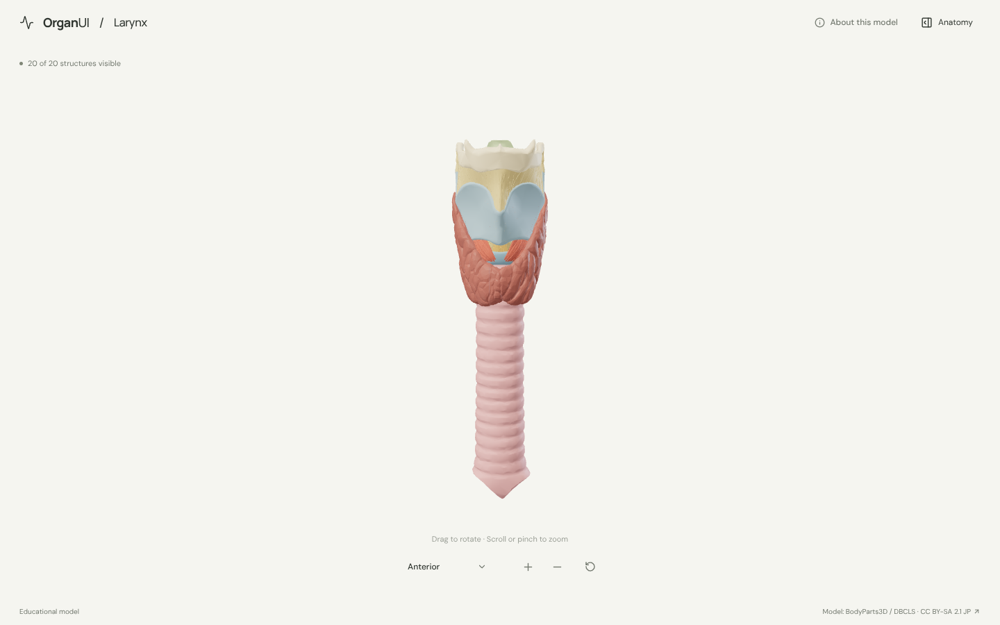
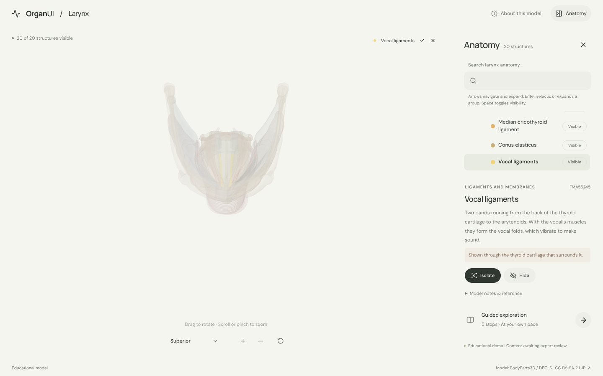
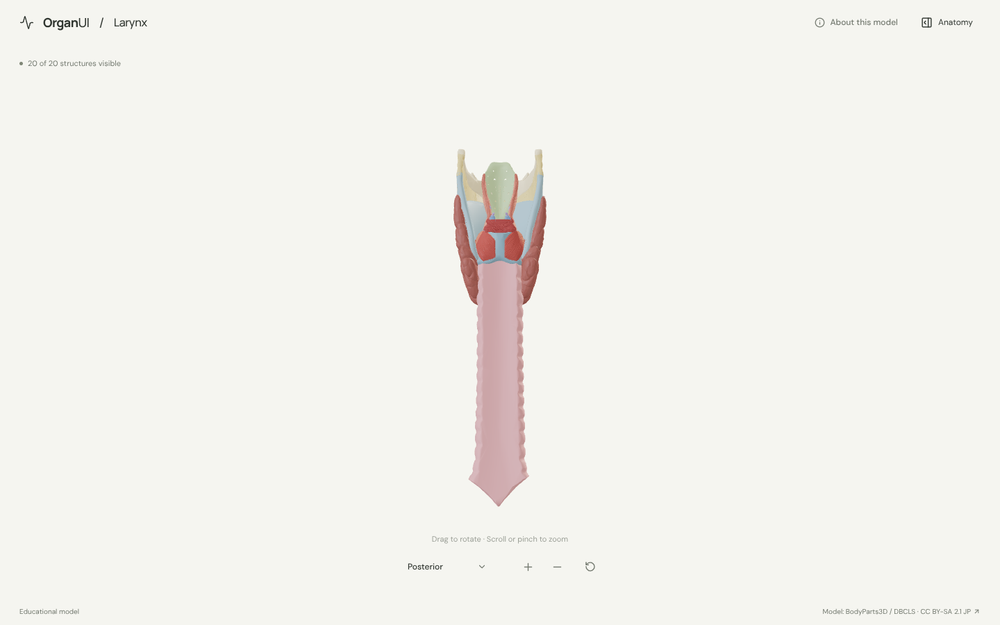
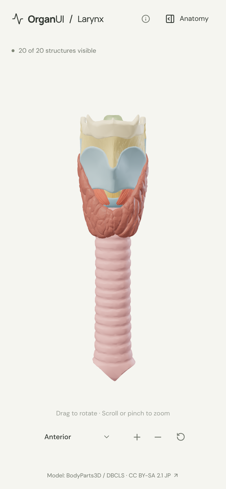

# OrganUI Larynx

A minimal, standalone, open-source anatomy explorer for the larynx and trachea built with React, TypeScript, Three.js, React Three Fiber, Vite, and Bun. It shares its interaction design and code with [OrganUI Heart](https://github.com/organui/heart-3d).

**Status:** working local demo. Twenty selectable structures from a real, openly licensed model, responsive layouts, and checked desktop/mobile interactions. Public deployment and clinical anatomy review have not been completed.



## Run locally

Install [Bun](https://bun.sh/) **1.4.2 or newer**, then:

```sh
git clone https://github.com/organui/larynx-3d.git
cd larynx-3d
bun install --frozen-lockfile
bun run dev
```

Open **http://127.0.0.1:5173**. No environment variables, accounts, API keys, sibling repositories, model downloads, or external font services are needed after dependency installation. The ready-to-use 5.3 MB GLB is in `public/models/`.

```sh
bun run typecheck       # TypeScript checks, including conversion scripts
bun run test            # Unit tests for selection emphasis, picking, ownership, and the anatomy-tree adapter
bun run verify:model    # Check the GLB hash, source IDs, element lists, and valid geometry
bun run build           # Typecheck and create dist/
bun run preview         # Serve the production build at http://127.0.0.1:4173
bun run format:check    # Check formatting
```

The app is static and uses relative build paths. No deployment has been per## Explore

- The larynx and trachea open in the anterior view with the hyoid bone above and the thyroid gland around the upper trachea. Open **Anatomy** in the header to browse structures.
- Drag to rotate; scroll or pinch to zoom. The view menu has anterior, posterior, left lateral and superior presets; the superior view looks down into the laryngeal inlet. Manual rotation changes its label to **Custom view**; zooming and selecting keep the view name.
- Select a mesh or use the anatomy tree (the OrganUI registry `anatomy-tree` component, see [registry integration](docs/REGISTRY_INTEGRATION.md)). The selected structure glows in its own colour and everything else is ghosted, so the vocal ligaments and the muscles inside the thyroid cartilage stay visible.
- Isolate a structure, hide it, or restore all. **Reset explorer** restores the anterior camera, visibility, selection, tree state and tour.
- Follow six guided stops: the thyroid and cricoid cartilages, the vocal ligaments, the muscle that opens the airway, the epiglottis, and the trachea.
- Keyboard: Tab/Enter for controls, arrow keys to rotate the focused model, `+`/`-` to zoom, Escape closes the panel and returns focus to its toggle.

toggle.

<details>
<summary>Selection, posterior view and mobile screenshots</summary>







</details>

## Model, credits, and license

> BodyParts3D / Anatomography, © The Database Center for Life Science (DBCLS), licensed under Creative Commons Attribution-Share Alike 2.1 Japan. Adapted by OrganUI.

The model is a curated subset of **BodyParts3D / Anatomography 4.3**: 45 source meshes grouped into 20 structures. The model data and screenshots of it are under **[CC BY-SA 2.1 Japan](https://creativecommons.org/licenses/by-sa/2.1/jp/deed.en)**, separately from this repository's **MIT code license**. Meshes come from a checksum-pinned public mirror and are cross-checked against the official 4.3 concept table. Read [model provenance](docs/MODEL_PROVENANCE.md), [asset attribution](public/models/ATTRIBUTION.md) and the [manifest](public/models/manifest.json).

Descriptions summarise the [NCI SEER Training larynx page](https://training.seer.cancer.gov/anatomy/respiratory/passages/larynx.html) and general anatomy. **Expert anatomical review is pending.** This is an educational interface demonstration, not a diagnostic or clinical tool.

Known limitations:

- Mucosa is not modelled, so the vocal folds appear as their ligaments and muscles, and the glottis is shown open. Left and right partners are grouped into one selectable structure each.
- The tracheal rings are part of one trachea surface. The main bronchi, esophagus, pharynx, extrinsic muscles, nerves and vessels are omitted.
- The camera orbits the centre of the whole model, which sits near the bottom of the larynx, so zooming in centres on the cricoid and upper trachea. Rotate or use the superior view to look into the larynx.
- Colours are illustrative.
- Browser checks used headless Chromium with software WebGL at desktop and phone viewport sizes, not physical devices or a screen-reader audit.

## License

Original application code: [MIT](LICENSE). Anatomy model, derived model images, fonts, and icons retain their separately documented licenses.

Part of [OrganUI](https://github.com/organui).
